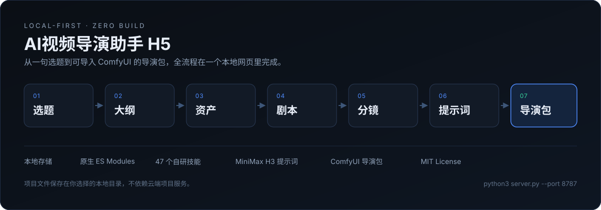

# AI 视频导演助手 H5

**从一句选题，到可直接导入 ComfyUI 的导演包。**

选题 → 大纲 → 资产 → 剧本 → 分镜 → 提示词 → 导演包，全流程在一个本地网页里完成。

[](LICENSE)


<p align="center">
  
</p>

**一个网页，把短剧从想法推到成片前一步：**

- **全流程不断链**：选题、大纲、角色 / 场景 / 道具 / 站位资产、分集剧本、分镜、H3 视频提示词，在同一个项目里推进。
- **47 个自研技能**：每个环节都有对应技能，可直接调用 LLM 生成，也可以手动修改。
- **导演包直连 ComfyUI**：一键导出 `*.mmxpack.zip`，含每镜提示词、时长、参考图与音色，直接导入 [`ComfyUI_MiniMaxH3_Director`](https://github.com/AIMixer/ComfyUI_MiniMaxH3_Director)；使用转场能力需要 [带转场的适配版节点](https://github.com/fresh-bird-No1/ComfyUI_MiniMaxH3_Director)。
- **零构建、本地优先**：原生 ES Modules，无 npm / 无打包；项目写在本地磁盘，浏览器清缓存也不丢。

如果这个项目对你有用，欢迎点一个 Star。本仓库是唯一官方源码仓库；如果你看到的是 fork，请回到上游仓库获取最新版本。

## 快速开始

环境要求：Python 3.8+、现代浏览器。AI 生成需要任意 OpenAI 兼容的 LLM API Key；生图和配音可选接本地 ComfyUI。

```bash
cd ai-video-director-h5
python3 server.py --port 8787
```

浏览器打开 <http://127.0.0.1:8787/>。

首次进入先选一个本地目录作为工作区，之后每次进入可以选择打开已有项目或新建项目。

> 不要直接双击 `index.html`：`file://` 下浏览器会拦截 ES Module 和 `fetch`，技能清单与 SKILL.md 读不出来，页面会空白。

## 工作流

| 阶段 | 主要产出 |
| --- | --- |
| 选题 | 剧名、题材、受众、调性、结局、集数、画风、创作方向 |
| 大纲 | 一句话故事、三幕、节奏、爽点、结局、付费卡点、角色名单、分集目录 |
| 资产 | 角色画像与音色、场景、道具、站位的设定卡与生图提示词 |
| 剧本 | 分集场次、动作、旁白、对白 |
| 分镜 | 每镜时长、景别、运镜、画面、时间轴、对白、本镜服装、转场 |
| 提示词 | 每镜 H3 中文 / 英文视频提示词与分镜图提示词 |
| 导演包 | 可直接导入 ComfyUI 的 `*.mmxpack.zip` |

## 数据保存

**磁盘是主存储**：

- 首次打开会要求选择工作目录（默认建议 `~/AI视频导演助手项目`，目录不存在会自动创建）。
- 选目录时点「浏览…」可拉起系统目录选择框（`GET /api/pick-dir`）：Windows 用 PowerShell + WinForms（对话框置于最前），macOS 用 `osascript`，Linux 用 `zenity` / `kdialog`；都不可用时退回手动填写路径。
- 每次进入都会先让你选：打开目录下已有项目，或新建项目。
- 结构：

```
<工作目录>/
  projects/<项目ID>/project.json   完整项目（含上传的图片、音频 data URL）
  packs/E01.mmxpack.zip            导出的导演包
```

- 保存时机：编辑时只改内存，**离开编辑框（change / focusout）后写盘**；切后台、关闭页面时立即补写一次。服务端用临时文件 + 原子替换，避免写一半损坏。
- 工作目录记在 `.workspace.json`（已加入 `.gitignore`），删除该文件即可重新选择目录。
- 浏览器 localStorage 只作为缓存副本（键名 `dm_h5_v1`），清站点数据不影响磁盘上的项目。

**接口**（均为同源 `/api/*`）：

| 方法 | 路径 | 用途 |
| --- | --- | --- |
| GET | `/api/status` | 是否在线、当前工作目录、建议目录 |
| POST | `/api/workspace` | `{"path": "..."}` 设置或创建工作目录 |
| GET | `/api/projects` | 列出工作目录下的项目（仅元信息） |
| GET | `/api/projects/<id>` | 读取完整项目 |
| PUT | `/api/projects/<id>` | 写入完整项目 |
| DELETE | `/api/projects/<id>` | 删除项目及其目录 |
| POST | `/api/packs/<name>` | 保存导演包（`*.mmxpack.zip`） |

服务只监听 `127.0.0.1`，项目 ID、包名、路径都做了校验，不做局域网访问。

## 导出导演包

顶栏「导出导演包」把当前集打成 `E01.mmxpack.zip`，可直接用于 `ComfyUI_MiniMaxH3_Director` 节点的「导入导演包」。

### 节点版本与转场

导演包需要配合 ComfyUI 的 `ComfyUI_MiniMaxH3_Director` 节点使用，两个版本的分工如下：

| 节点 | 地址 | 能力 |
| --- | --- | --- |
| 上游原版 | <https://github.com/AIMixer/ComfyUI_MiniMaxH3_Director> | 镜头组导入与视频生成 |
| 本项目适配版 | <https://github.com/fresh-bird-No1/ComfyUI_MiniMaxH3_Director> | 在上游原版基础上增加转场能力 |

- 不带转场的导演包，两个版本都能导入。
- 带转场的导演包会多出 `pack.json` 的 `transitions` 字段和 `transitions/NN.json`，必须用**本项目适配版**节点导入；上游原版没有转场任务处理，导入后不会生成转场片段。
- 转场片段是独立的 fl2v 任务：首帧取上一镜尾帧、尾帧取下一镜首帧，音轨固定静音。

通过 `server.py` 打开时，包直接写到 `<工作目录>/packs/`，提示里会给出完整路径；服务不可用时退回浏览器下载。

包内结构（与 `ComfyUI_MiniMaxH3_Director/director/pack.py` 对齐）：

```
pack.json                          format / formatVersion / taskType / widgets / output / sequence / transitions
shared_params/shared_params.json   公共段，默认空
asset_groups/NN/group.json         一镜一段：prompt、durationSec、frameCount、start、refs、refAudios
asset_groups/NN/PictureN.<ext>     角色、场景、道具、服装参考图
asset_groups/NN/AudioN.<ext>       角色音色
transitions/NN.json                fl2v 转场任务：首帧取上一组尾帧、尾帧取下一组首帧（仅适配版节点读取）
```

- `sequence` 给出最终拼接顺序：正常镜头组与转场交替排列。
- 不写 `timeline.json`，导入端会用 `_assemble_timeline` 从各 `group.json` 重新组装。
- 参考图顺序：角色 → 场景 → 道具 → 服装，记为 `Picture1..N`；音色记为 `Audio1..N`。服装是角色卡内的子资源，按一整套搭配出图且不露脸；分镜表的「本镜服装」列按 `角色名：服装名称` 指定这一镜穿哪套，导演包按该字段精确取图，没有该字段时按服装名是否出现在画面/对白/资产里兜底。
- 有参考图的镜标 `r2v`，没有的标 `t2v`，`pack.json` 里是 `mixed`；默认 1280×720、24fps。
- 导出前必须有分镜；只有剧本时不会自动拆镜。
- 图片/音频支持 data URL（手动上传的）和 ComfyUI `/view` URL（导出时现抓字节）；抓不到就跳过该素材，并在 toast 里提示跳过的数量。
- 转场在导演包里是独立的 fl2v 任务，时长在 1.6–3 秒之间按镜头内容选择，成片音轨固定为静音。这部分只有本项目适配版节点会读取。

## 接入 ComfyUI（生图 / 配音 / 抓图）

设置里的「生图模型」「音频模型」都走 ComfyUI 的 API 格式工作流：POST `/prompt` 提交，轮询 `/history/{prompt_id}`，用 `/view` 取结果。需要 ComfyUI 以 API 格式保存的工作流 JSON。

### 必须给 ComfyUI 加 `--enable-cors-header`

`--enable-cors-header` 是 **ComfyUI 服务端**的启动参数，由启动 ComfyUI 的人添加，不在本项目代码里，页面端也无法运行时设置。加完重启生效。

原因：本项目跑在 `127.0.0.1:8787`，ComfyUI 跑在 `127.0.0.1:8188`，端口不同即不同源，浏览器会按 CORS 策略拦截页面读取响应。受影响的链路：

- 测试连接 → `GET /system_stats`
- 出图 / 配音 → `POST /prompt`、`GET /history/{id}`
- 导出导演包抓图 → `GET /view?filename=...`

没有这个头时控制台会报 `blocked by CORS policy`，表现为「请求发出去了但拿不到结果」。

添加方式：

- 便携版 Windows：在 `run_nvidia_gpu.bat` 的 `python main.py` 后追加 `--enable-cors-header`
- 手动启动：`python main.py --enable-cors-header`
- Docker：追加到容器启动命令
- ComfyUI Desktop：加入启动/额外命令行参数

替代方案：用同源反向代理把 `/comfy/*` 转到 `127.0.0.1:8188`，本项目里把 ComfyUI Server 填成代理地址；当前 `server.py` 只做静态托管与项目落盘，不带 ComfyUI 代理，需要的话得自己加。

## 目录

```
index.html        入口
server.py         本地服务：静态托管 + 项目/导演包落盘
css/app.css       全部样式
js/store.js       数据模型、localStorage 缓存
js/server.js      落盘接口客户端
js/skills.js      技能清单、技能选择、system prompt 拼装
js/agent.js       OpenAI 兼容对话、模型列表、出图/配音
js/comfy.js       ComfyUI 工作流解析与执行
js/pack.js        导演包（mmxpack.zip）生成
js/render.js      各阶段页面渲染
js/main.js        事件绑定与业务编排
skills-clean/     47 个自研 Skill
docs/             工作流图等文档资源
LICENSE           MIT License
```

`skills-clean/manifest.json` 是技能清单，`js/skills.js` 只读取这一套。

## 常见问题

**页面空白 / 技能加载失败？**
通过 `python3 server.py` 打开，不要直接双击 `index.html`。`file://` 下浏览器会拦截 ES Module 和 `fetch`。

**能不用 ComfyUI 吗？**
可以。选题、大纲、剧本、分镜、提示词和导演包导出都不依赖 ComfyUI；只有「出图」「生成音色」需要配置 ComfyUI 工作流。

**AI 生成必须联网吗？**
需要任意 OpenAI 兼容的 LLM 接口。你可以填 OpenAI、DeepSeek、Moonshot、智谱、通义、硅基流动、OpenRouter 或自建兼容服务。

**项目数据在哪？会上传吗？**
项目文件和上传的图片、音频保存在你自己选的工作目录里，不会上传到本项目的服务器。使用 Agent 生成时，当前阶段相关的项目内容会发送给你配置的 LLM 接口；API Key 只保存在浏览器本地和请求头里。

**视频在哪里生成？**
本项目负责到提示词和导演包；视频由 ComfyUI 侧的 `MiniMaxH3_Director` 节点生成。上游原版见 <https://github.com/AIMixer/ComfyUI_MiniMaxH3_Director>；需要转场就装本项目适配版 <https://github.com/fresh-bird-No1/ComfyUI_MiniMaxH3_Director>，详见[节点版本与转场](#节点版本与转场)。

## 参与贡献

- 欢迎提交 Issue 和 PR，请尽量附上复现步骤、浏览器版本和相关截图。
- `skills-clean/` 下的技能文本必须是原创或已获授权，不接受从第三方复制的内容。
- 不要提交 API Key、个人项目数据、生成出来的大体积图片/视频或打包产物。
- 提交前确认 `python3 server.py` 能正常启动，页面无控制台报错。

## 许可证

本项目代码与 `skills-clean/` 下的技能文本统一采用 [MIT License](LICENSE)。

ComfyUI、Electron 以及各家 LLM / 图像 / 音频服务不属于本仓库，遵循各自的许可证与服务条款；仓库不包含任何第三方专有技能内容。

## English

**AI Video Director Assistant H5** is a local-first, zero-build web app for short-drama production. It takes a topic through outline, character/scene/prop assets, script, shot list, MiniMax H3 prompts, and exports a ComfyUI-ready director pack. All project data stays on your machine.

The exported pack targets [ComfyUI_MiniMaxH3_Director](https://github.com/AIMixer/ComfyUI_MiniMaxH3_Director). Adding transitions requires the [transition-enabled build](https://github.com/fresh-bird-No1/ComfyUI_MiniMaxH3_Director).

```bash
python3 server.py --port 8787
```

Open <http://127.0.0.1:8787/>. Requires Python 3.8+ and any OpenAI-compatible LLM API for AI generation; ComfyUI is optional for image and voice generation.

MIT licensed. If you find it useful, a star is appreciated.
